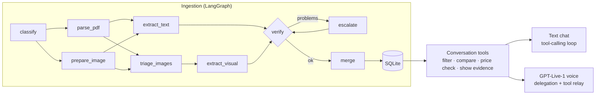

# real-estate-multimodal-agent

**ListingLens** — a voice-first assistant that reads the documents a broker sent you (PDF brochures,
floor plans, phone photos of price sheets), extracts **verified facts with evidence**, and helps you
pick an apartment in a real-time conversation.


> "I need at least two bedrooms." · "And I really want a barbecue grill." → the assistant narrows
> it down to one apartment and **opens the floor plan where the grill is drawn** — a fact that
> appears in no text anywhere.


## What it demonstrates

| | How |
|---|---|
| **Document intelligence** | PDF text layer read for free with PyMuPDF; embedded images, floor plans and a tilted, blurry phone photo read by vision models |
| **LLM orchestration** | LangGraph ingestion graph: parallel branches, image triage, verification, one escalation to a different provider, merge |
| **Evidence, not vibes** | Every fact keeps its document, page, highlight box, quote, method and model; disagreements between documents are kept as conflicts |
| **Cost-aware routing** | Native text never hits a vision model; a cheap model reads everything and a strong one only retries readings that fail verification — chosen by eval (7.8× cheaper than the cautious design, same accuracy); cost logged per call |
| **Evals** | Synthetic dataset with exact ground truth and designed traps; accuracy per source type × cost per model setup |
| **Real-time voice** | OpenAI GPT-Live-1 over WebRTC, delegating to a backend model that calls the same deterministic tools as the text chat |

## How it works



1. **Read cheaply first.** A brochure's text layer is free. Images are triaged by a cheap vision
   call; decorative photos stop there.
2. **Read with the cheapest model that works.** Text, floor plans, charts and photos go to the
   model the routing assigns per task (`backend/app/ingestion/routing.py`) — by default a cheap
   one, because the eval showed it's enough.
3. **Check every reading.** Too few chart points, rooms that don't add up to the stated area,
   a photo with no prices → one retry on a stronger model.
4. **Merge into apartments.** Documents are matched by printed title; native text beats vision;
   price per m² is always computed; a room labeled *office* becomes a "2 or 3 bedrooms?" conflict.
5. **Talk.** Text or voice, the assistant only states facts that come from tools over the merged
   data — and its tool calls drive the screen (highlight cards, open evidence).

Details: [`docs/architecture.md`](docs/architecture.md) · flows: [ingestion](docs/flows/01-document-ingestion.md),
[conversation](docs/flows/02-assistant-conversation.md), [voice](docs/flows/03-voice-session.md).


## Evals: I designed for hard cases, then measured

The routing started **cautious**: strong vision models for floor plans, charts and photos. Before
keeping it, I measured it against the alternatives on the dataset's ground truth (OpenAI models,
one full ingestion per setup):

| Setup | Accuracy | Cost per run | vs. cheap-first |
|---|---|---|---|
| **cheap-first** (default): `gpt-6-luna` everywhere, `gpt-6.1-sol` only to retry failed readings | **100%** | **$0.0049** | — |
| cautious: `gpt-6.1-sol` for floor plans, charts and photos | 100% | $0.0381 | 7.8× more |
| single model: `gpt-6.1-sol` for everything | 100% | $0.0846 | 17× more |

**The cheap model read everything correctly — including the floor plans, the unlabeled chart and
the tilted phone photo — so the default is now cheap-first.** The strong model stays as a safety
net: verification catches implausible readings (too few chart points, rooms that don't add up)
and retries them once on a stronger model, so you only pay for it when a reading looks wrong.

**The honest caveat:** 4 synthetic listings is a small test set, and a benchmark where every setup
scores 100% can't rank models any further. With messier real documents I'd expect the hard cases
to separate models again — the routing is one config change (`backend/app/ingestion/routing.py`),
re-validated by the same eval:

```bash
backend/.venv/Scripts/python -m evals.run     # both strategies + single-model baselines
```

Scores are per source type (brochure text, phone photo, floor plan, chart, conflicts). Full
results: [`evals/results/openai-latest.md`](evals/results/openai-latest.md) ·
method: [`evals/README.md`](evals/README.md).

## Run it

Requirements: Python 3.13+, Node 22+.

```bash
# Windows: double-click _run/win.bat   ·   macOS: _run/mac.command
```

Then open http://localhost:5173 and click **Try sample documents** (or drop your own files).

Keys go in `backend/.env` (created from `.env.example` on first run):

| Key | Used for |
|---|---|
| `OPENROUTER_API_KEY` | extraction + chat with Claude / GPT / Gemini through one key |
| `OPENAI_API_KEY` | voice (GPT-Live-1 is OpenAI-only); also extraction + chat if there's no OpenRouter key |

**No keys?** The app runs in **offline mode** (badge in the header): model answers come from
canned fixtures generated from the dataset, so the whole flow can be explored for free. Offline
answers are a test double, not model results.

Tests: `cd backend && .venv/Scripts/python -m pytest` · `backend/.venv/Scripts/python -m pytest dataset evals`

## Project layout

```
backend/app/ingestion/   LangGraph graph, nodes, PDF parsing, merge, prompts, routing, LLM client
backend/app/assistant/   conversation tools, chat loop, offline agent
backend/app/live/        GPT-Live-1 session config
backend/app/api/         FastAPI routes (uploads, SSE narration, listings, chat, voice)
frontend/src/features/   ingestion, listings, evidence viewer, chat thread, voice
dataset/                 synthetic listings + ground truth (generated from spec.py)
evals/                   scoring + model comparison
docs/                    plan, architecture, decisions, flows, changelog
```

Stack: FastAPI · LangGraph · PyMuPDF · SQLite/SQLAlchemy · OpenAI SDK (OpenRouter + GPT-Live) ·
React 19 · Vite · Tailwind · shadcn/ui · assistant-ui.

## Limitations

- The dataset is synthetic (4 listings): great for exact scoring, small for ranking close models.
- Confidence values are heuristics, not calibrated probabilities.
- Model readings vary between runs (e.g. one run missed the "gourmet balcony" label on a floor
  plan that other runs read); the eval runs each setup once.
- Floor-plan evidence highlights the whole image (vision readings don't return coordinates yet).
- Single-process demo: ingestion runs are in-process background tasks.

Design decisions and trade-offs: [`docs/DECISIONS.md`](docs/DECISIONS.md).
