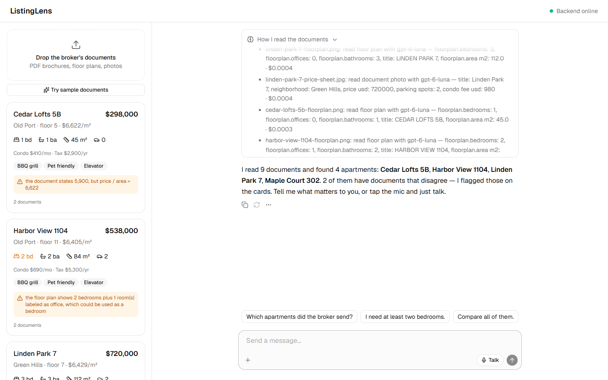
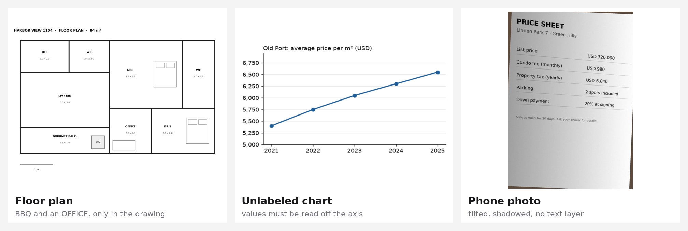
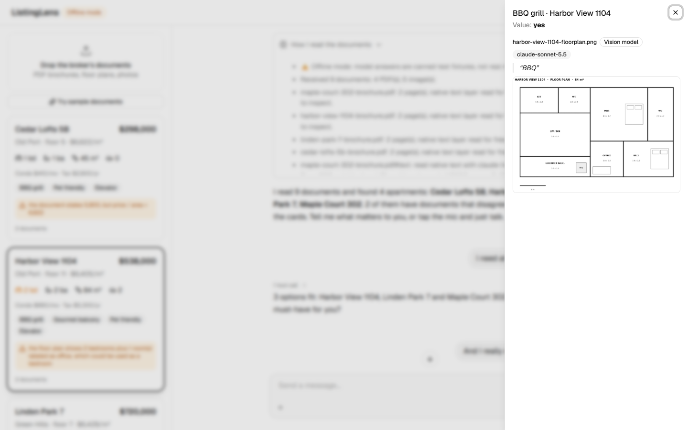
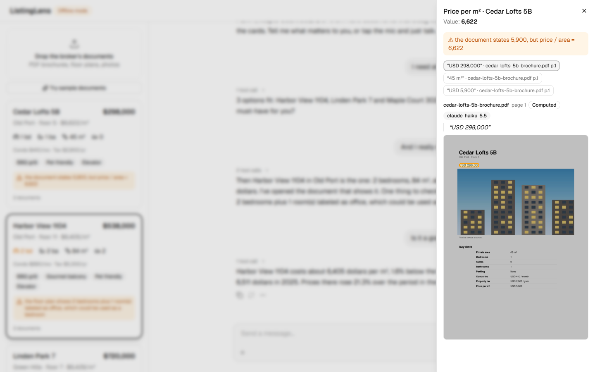
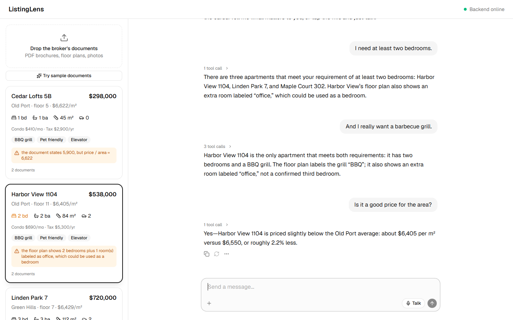
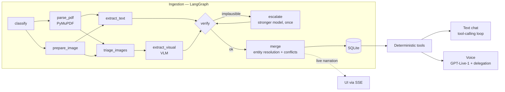

<div align="center">

# 🔎 ListingLens

**A multimodal document-intelligence agent for real estate.**
It reads the brochures, floor plans and phone photos a broker sends you, extracts every fact
*with the evidence behind it*, flags where the documents disagree — and lets you choose an
apartment by simply talking to it.




</div>

---

## Why this is hard

Real-estate documents are not text files. The facts that decide a purchase are spread across
formats, and some of them exist **only as pixels**:



| Where the fact lives | Example in the sample set | What ListingLens does |
|---|---|---|
| PDF text layer | price, area, bedrooms in a brochure | Reads it **for free** with PyMuPDF, keeping each value's position on the page |
| Architectural drawing | a BBQ grill and a room labeled `OFFICE` exist only on the floor plan | Vision model reads rooms in real-estate shorthand (`MBR`, `BR`, `WC`) and drawn amenities |
| Chart without data labels | 5-year price-per-m² trend for the neighborhood | Vision model reads the series off the axis; a plausibility check catches bad readings |
| Photo of a printed page | condo fee and property tax only on a tilted, shadowed price sheet | Routed to a vision model as a "document photo" |
| Two documents that disagree | brochure says 2 bedrooms, plan shows 2 + office; stated price/m² ≠ price ÷ area | **Keeps both values as a conflict** instead of silently picking one |

## Every answer comes with its source

Each extracted value keeps its document, page, highlighted region, verbatim quote, extraction
method (PDF text layer · vision model · computed) and the model that read it. Click any value —
or let the assistant open it for you.

<table>
<tr>
<td width="50%"></td>
<td width="50%"></td>
</tr>
<tr>
<td><sub>"…and I really want a barbecue grill." The only proof is a symbol on the floor plan — the assistant opens it.</sub></td>
<td><sub>The brochure states USD 5,900/m²; price ÷ area is 6,622. Both values are kept, with their sources.</sub></td>
</tr>
</table>

## Just talk to it

Ask by text, or press **Talk** for a real-time voice conversation (OpenAI GPT-Live-1 over WebRTC).
Requirements accumulate, conflicts are mentioned out loud, and every lookup drives the screen:
matching cards light up and the evidence opens by itself.



The assistant never states a fact from memory: it can only answer through deterministic tools over
the verified data (`filter_listings`, `compare_listings`, `neighborhood_price_check`,
`show_evidence`, …). Text chat and voice share the same tools.

---

## How it works



1. **Parse before you pay.** PyMuPDF extracts the text layer, every meaningful embedded image and a
   render of each page. Native text never goes to a vision model.
2. **Triage images.** A cheap vision call labels each image — floor plan, chart, document photo or
   just a property photo. Decorative photos stop here.
3. **Extract with structured outputs.** Each task has its own prompt and a strict Pydantic schema;
   text answers include verbatim quotes, which are located back in the PDF to get a highlight box.
4. **Verify, then escalate once.** Readings are checked for completeness and plausibility (too few
   chart points, room sizes that don't add up to the stated area, a photo with no prices). A failed
   reading is retried once on a stronger model — bounded cost, no loops.
5. **Merge into apartments.** Documents are matched by their printed title (entity resolution);
   native text beats vision; price per m² is always recomputed; disagreements become conflicts.
6. **Narrate everything.** Every node streams what it's doing over SSE, so you watch the pipeline
   work — with cost per call.

## Designed for hard cases, then measured

The routing started *cautious*: strong vision models for floor plans, charts and photos. Before
keeping it, I measured the alternatives against the dataset's ground truth (one full ingestion
of all 9 documents per setup):

| Setup | Accuracy | Cost per run | vs. cheap-first |
|---|---|---|---|
| **cheap-first** (default) — `gpt-6-luna` everywhere, `gpt-6.1-sol` only to retry failed readings | **100%** | **$0.0049** | — |
| cautious — `gpt-6.1-sol` for floor plans, charts and photos | 100% | $0.0381 | 7.8× more |
| single strong model — `gpt-6.1-sol` for everything | 100% | $0.0846 | 17× more |

**The cheap model read everything correctly — floor plans, the unlabeled chart and the phone photo
included — so cheap-first is the default.** The strong model stays as a safety net, paid for only
when verification flags a reading.

The honest caveat: four synthetic listings is a small test set, and when every setup scores 100%
the benchmark can't rank models any further. With messier real documents I'd expect hard cases to
separate models again — routing is one config change, re-validated by the same eval. Scores are
reported per source type (brochure text, phone photo, floor plan, chart, conflicts):
[results](evals/results/openai-latest.md) · [method](evals/README.md).

## Engineering highlights

- **Ground truth by construction** — the dataset is generated from one spec, so documents and
  expected answers can't drift; traps are explicit (`dataset/spec.py`). Generation is byte-deterministic.
- **Evidence is a first-class output** — every fact is an `Observation(field, value, evidence)`
  before merging, so merge and conflict logic are model-agnostic and unit-tested.
- **Provider-agnostic model layer** — one `complete_json(schema=…)` call over OpenRouter (Claude,
  GPT, Gemini with one key) or OpenAI directly; cost logged per call; model routing is data, not code.
- **Reload-safe live narration** — events are stored and streamed; a reconnecting browser replays
  from `Last-Event-ID` and then follows the live run.
- **Secure voice** — the browser sends its WebRTC offer to the backend, which creates the GPT-Live
  session; the API key never reaches the client.
- **Explorable without keys** — offline mode runs the full pipeline and UI on canned answers
  (clearly labeled), which also makes the tests deterministic.

## Run it

Requirements: Python 3.13+ and Node 22+.

```bash
# Windows: double-click _run/win.bat   ·   macOS: _run/mac.command
```

Open http://localhost:5173 and click **Try sample documents** (or drop your own files).
Keys go in `backend/.env` (created from `.env.example` on first run):

| Key | Used for |
|---|---|
| `OPENAI_API_KEY` | extraction + chat with OpenAI models, and voice (GPT-Live-1 is OpenAI-only) |
| `OPENROUTER_API_KEY` | optional — extraction + chat with Claude / GPT / Gemini through one key |

No keys? The app runs in **offline mode**: answers come from canned fixtures, so you can explore
the whole flow for free.

```bash
cd backend && .venv/Scripts/python -m pytest                # 42 backend tests
backend/.venv/Scripts/python -m pytest dataset evals        # dataset + scorer tests
backend/.venv/Scripts/python -m app.ingestion ../dataset/listings   # pipeline from the CLI
```

## Project layout

```
backend/app/ingestion/   LangGraph graph, nodes, PDF parsing, verification, merge, prompts, routing
backend/app/assistant/   conversation tools, chat loop (Responses API / Chat Completions)
backend/app/live/        GPT-Live-1 session config (voice)
backend/app/api/         FastAPI routes: uploads, SSE narration, listings, evidence files, chat, voice
frontend/src/features/   ingestion, listing cards, evidence viewer, chat thread, voice controls
dataset/                 synthetic listings + ground truth, generated from spec.py
evals/                   scoring per source type + model comparison
docs/                    architecture, decisions (ADRs), end-to-end flows, changelog
```

**Stack:** Python · FastAPI · LangGraph · PyMuPDF · Pydantic · SQLAlchemy/SQLite · OpenAI SDK
(OpenRouter, Responses API, GPT-Live-1) · React 19 · Vite · Tailwind · shadcn/ui · assistant-ui.

## Limitations

- The dataset is synthetic (4 listings, 9 documents): exact scoring, but small.
- Confidence values are heuristics, not calibrated probabilities.
- Model readings vary between runs (one run missed a "gourmet balcony" label that others read);
  the eval runs each setup once.
- Floor-plan evidence highlights the whole image — vision readings don't return coordinates yet.
- Single-process demo: ingestion runs are in-process background tasks.

More: [architecture](docs/architecture.md) · [design decisions](docs/DECISIONS.md) ·
flows: [ingestion](docs/flows/01-document-ingestion.md), [conversation](docs/flows/02-assistant-conversation.md),
[voice](docs/flows/03-voice-session.md).
